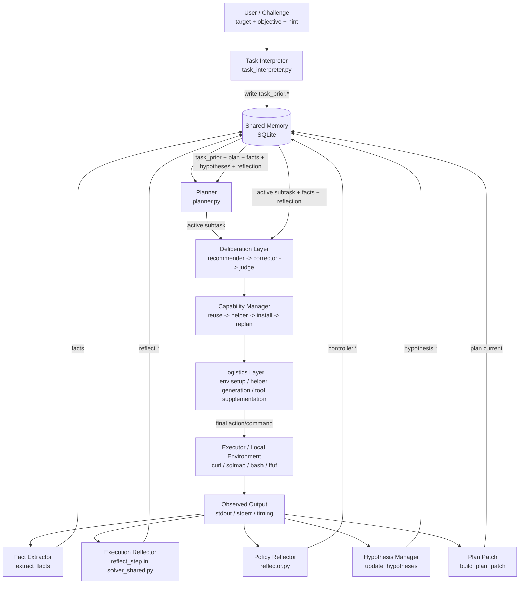

# Blackbox CTF Agent + Knowledge Base

This repo is a local-first blackbox CTF workspace powered by a native Claude Agent SDK loop. Public knowledge comes from Claude's WebSearch/WebFetch; local and run-specific evidence stays in the workspace and content-addressed artifact store.

## Layout

- `repos/`: legacy upstream knowledge submodules retained for historical review; not loaded by the runtime
- `notes/`: historical design notes
- `scripts/`: run entrypoints and deterministic helper tools
- `web_agent/`: pure SDK runtime, session/artifact infrastructure, plus the optional governed runtime
- `docs/`: architecture and iteration notes (`init`, `pentagi`)

File map:

```text
mako/
  README.md
  SKILL.md
  .env.example
  docs/
    init.md
    pentagi.md
    claude-sdk.md
    runtime_claude_contract.md
  web_agent/
    claude_runtime.py
    pure_sdk_agent.py
    shared_session.py
    session_ledger.py
    followup.py
    artifact_workspace.py
    artifact_tools.py
    cmd_agent.py
    solver_shared.py
    planner.py
    deliberation.py
    reflector.py
    capability.py
    logistics.py
    task_interpreter.py
  scripts/
    run_web_agent.sh
    followup.sh
  tests/
    test_deliberation.py
    test_policy_control.py
    test_structured_actions.py
```

## Design Docs

- `docs/init.md`: current baseline thinking after removing legacy `sync/`
- `docs/pentagi.md`: PentAGI-driven integration notes and follow-up decisions
  - includes NYU Web smoke rerun notes (`2026-04-11`) with intended-exploit verification and reliability-evaluation boundaries
- `docs/claude-sdk.md`: Claude Agent SDK runtime, session, authentication, and retrieval boundaries
- `docs/runtime_claude_contract.md`: completion and execution semantics used only by the optional governed runtime

## Setup

1. Create a virtual environment and install the runtime dependency:

```bash
cd mako
uv venv .venv
uv pip install --python .venv/bin/python -r requirements.txt
```

2. Create the environment file:

```bash
cp .env.example .env
```

3. If Claude CLI is already signed in, the default pure runtime needs no additional credential. For API or gateway authentication, edit `.env` and set one credential plus any endpoint/model overrides:

```bash
ANTHROPIC_API_KEY=your_key
```

`ANTHROPIC_AUTH_TOKEN` is the alternative for gateways that require bearer authentication. The optional governed runtime still requires an explicit credential and model.

## Pure SDK Agent (Default)

Run the target directly:

```bash
./scripts/run_web_agent.sh "http://127.0.0.1:8080/" "Find SQL injection and retrieve flag"
```

This launches one unrestricted Claude Agent SDK loop with Claude Code's default tools and system prompt under `bypassPermissions`. Mako does not select phases, validate commands, gate tool calls, inject planner actions, cap agent turns, or run its own executor. User/project/local Claude settings, Skills, plugins, MCP servers, and an existing Claude CLI login are discovered by the SDK defaults. Claude Code or organization-managed policies may still enforce their own native restrictions; pure mode adds no Mako restrictions on top.

The shared SDK session is stored at `logs/claude_sdk_shared_context.json`. Every invocation resumes that session when the endpoint/model/config identity matches, so tool results and conversation history remain available across runs. Run/session topology, call receipts, cost, turns, and terminal status are recorded separately in `logs/mako_session_ledger.sqlite`; the ledger does not copy the SDK transcript or maintain cognitive facts.

To deliberately start over, invoke the module with `--new-session`:

```bash
.venv/bin/python -m web_agent.pure_sdk_agent \
  --target "http://127.0.0.1:8080/" \
  --objective "Find SQL injection and retrieve flag" \
  --new-session
```

Pure-run summaries are written under `artifacts/mako/<run_id>/pure_sdk_run.json`; they contain event types, tool names, artifact receipt references, usage, result text, and the session ID, but not tool inputs or SDK stderr.

### Content-addressed Artifact Workspace

Pure and follow-up runs share `artifacts/mako/_evidence`. Raw SDK tool results and ordinary files written under the run artifact directory are passively captured as immutable SHA-256 objects. Identical bytes share one object while each observation receives its own append-only provenance receipt containing run, session, call, tool, source kind, and source reference.

Mako exposes the following SDK-native MCP tools without changing Claude's permissions or action policy:

- `artifact_capture`: explicitly preserve an existing file;
- `artifact_list`: list receipts from the current run;
- `artifact_peek`: read a bounded line range or literal-query result from a text artifact.

Binary artifacts return metadata only. Tool-use inputs are not persisted, Mako Artifact MCP results are not recursively captured, and every object is size/hash verified when read. The model decides if and when to use these tools; no artifact content is automatically injected into its prompt.

### Native follow-up and forks

Continue the latest run without a planner or prompt rewrite:

```bash
./scripts/followup.sh --mode resume --message "Continue solving from the current evidence"
```

The modes are:

- `inspect`: ask the same session to explain or inspect its current work;
- `resume`: continue solving in the same session;
- `fork`: create a new SDK session from the selected run's recorded message checkpoint.

Pass `--run-id <id>` to target a non-latest run. Every follow-up creates an immutable child run and an intervention receipt. Forks record both run and session parentage; ordinary resume/inspect keeps the same session. Mako sends the operator message directly to the SDK and does not translate it into a plan or task.

## Local Run Dashboard

Start the read-only web dashboard:

```bash
./scripts/dashboard.sh
```

Open `http://127.0.0.1:8765/` to inspect a Cairn-style provenance canvas: stated target/objective endpoints, run/session lineage, SDK calls, follow-up edges, grouped evidence receipts, token/cost totals, and run summaries. Clicking a node highlights its upstream/downstream lineage; the inspector has `Detail`, `Evidence`, and `Log` tabs. `Replay` reconstructs progress from stored timestamps, and `Snapshot` exports a timeline or JSON graph.

The dashboard is deliberately evidence/provenance-oriented rather than a fact/intent blackboard: it only reads `logs/mako_session_ledger.sqlite`, `artifacts/mako/_evidence`, and run-record JSON files under the project/artifact roots; it does not start agents, mutate run state, or infer cognitive facts from artifacts.

Use `--port <port>` to change the bind port, `--host <host>` to expose a different interface, and `--open` to launch a browser automatically:

```bash
./scripts/dashboard.sh --port 9000 --open
```

## Governed Runtime (Optional)

The previous interpreter/planner/validator runtime remains available for regression comparison and conservative runs:

```bash
MAKO_RUNTIME_MODE=governed \
  ./scripts/run_web_agent.sh "http://127.0.0.1:8080/" "Find SQL injection and retrieve flag"
```

Governed architecture:

1. `task_interpreter` reads `objective + hint + observed signals`
2. interpreter writes `task_prior.*` into shared sqlite memory
3. planner turns priors and runtime evidence into explicit subtasks
4. solver deliberation reads:
   - task priors
   - active subtask
   - persistent facts
   - hypotheses
   - reflection constraints
5. controller reflection emits evidence-based policy advice
6. the autonomy layer keeps semantic advice non-blocking by default while preserving hard execution and completion invariants
7. in `claude` mode, a single Claude tactical solver owns the next executable step
8. in `claude_collab` mode, a counter-solver and corrector challenge that step before execution
9. capability manager evaluates execution gaps (`reuse existing action` vs `write helper` vs `install dependency` vs `replan`)
10. logistics layer executes environment/setup work requested by capability resolution and records it outside challenge-step counting
11. command output updates:
   - facts
   - reflection state
   - hypothesis lifecycle
   - plan patches for follow-up subtasks

`claude_collab` runs also write `artifacts/.../<run_id>/claude_dialogue.jsonl`, which records the counter-solver and tactical solver prompts/replies for post-run inspection.
12. interpreter/planner are refreshed periodically or after drift / repeated low-gain failure

Architecture diagram:



Governed runtime stack:

```text
task_interpreter -> planner -> Claude tactical solver
                   -> optional counter-solver / corrector
                   -> capability -> logistics -> executor
executor -> fact extraction / hypothesis updates / execution reflection / policy reflection
          -> plan patch -> planner
```

### Governed-runtime autonomy

`adaptive` is the default autonomy mode. Planner actions, phase recommendations, controller families, semantic-recovery rules, and soft branch-shift requests are advisory: Claude may reject them when runtime evidence supports another route. Exact duplicate suppression, preflight validation, tool budgets, evidence-backed completion, and hard zero-gain circuit breakers remain enforced.

Use `--autonomy-mode guarded` (or the corresponding setting in `.env.example`) to restore blocking semantic policies. `--force-debate` adds the counter-solver/corrector around ordinary Claude runs; `claude_collab` always enables that debate. Runtime defaults and environment names are defined in `.env.example`.

Shared-memory data model:

```text
task_prior.*   -> interpreter-produced priors
facts          -> runtime observations and extracted signals
reflect.*      -> failure reason, strategy update, next-step constraints
plan.*         -> current plan, active subtask title/phase/action hint
controller.*   -> policy reflection outputs (must_do / must_avoid / clusters)
hypothesis.*   -> candidate / confirmed / weak_candidate / rejected
run.*          -> challenge-step and capability-step counters
events         -> compact execution trace
flows          -> run-level status
tasks_state    -> objective-level execution status
subtasks_state -> step-level execution status and outcome
```

The authoritative environment-variable list is `.env.example`. The generation model is selected with:

```bash
ANTHROPIC_MODEL=your-model
```

The default pure runtime delegates the full agent loop and tool execution to `claude-agent-sdk`. In governed mode, SDK built-in tools remain disabled and Mako retains command validation/execution; its per-role session IDs are stored separately from the pure shared session.

Main modules:

1. `web_agent/pure_sdk_agent.py`, `web_agent/shared_session.py`, `web_agent/session_ledger.py`, `web_agent/followup.py`, `web_agent/artifact_workspace.py`, `web_agent/artifact_tools.py`
2. `web_agent/claude_runtime.py`
3. `web_agent/task_interpreter.py`
4. `web_agent/planner.py`
5. `web_agent/deliberation.py`
6. `web_agent/capability.py`
7. `web_agent/logistics.py`
8. `web_agent/reflector.py`
9. `web_agent/solver_shared.py`, `web_agent/cmd_agent.py`

The governed execution workflow is phase-based:

1. recon
2. probe
3. exploit
4. extract
5. verify
6. summarize and save run log to `logs/cmd_agent_last_run.json`

Memory database:

1. default path: `logs/agent_memory.sqlite`
2. shared by interpreter and solver under one `run_id`
3. stores:
   - `task_prior.*`
   - extracted `facts`
   - `reflect.*`
   - `hypothesis.*`
4. designed to be vuln-agnostic (not SQL-only)

Control policy:

1. phase state remains observable as `recon -> probe -> exploit -> extract -> verify`, but is advisory in `adaptive` mode
2. interpreter priors and planner subtasks provide discussion context rather than command authority
3. the tactical solver may agree with, adapt, or reject the active subtask's suggested action
4. reflector/controller outputs guide replanning; only hard evidence-free-loop thresholds force a branch shift in `adaptive` mode
5. action policy keeps semantic and controller rules modular and can restore blocking behavior through `guarded` mode
6. failure reasons are normalized and mapped to canonical failure clusters
7. capability acquisition is a separate loop and does not consume challenge-step budget
8. each step records an `info_gain` score from newly discovered facts
9. each step generates a `reflection`
10. hypotheses are explicitly tracked as:
   - `candidate`
   - `confirmed`
   - `weak_candidate`
   - `rejected`

Interpreter behavior:

1. converts `description + shown information` into `task_prior`
2. identifies likely challenge family and tech stack
3. proposes:
   - primary hypotheses
   - secondary hypotheses
   - deprioritized routes
   - exploit chain candidates
4. warns about weak routes without preventing evidence-backed exploration in `adaptive` mode

Deliberation behavior:

1. the Claude tactical solver proposes one executable step for the active subtask
2. planner action hints remain advisory in `adaptive` mode
3. counter-solver/corrector review runs only when explicitly requested or in `claude_collab`
4. execution results are written back into memory
5. reflection and planner patches update subsequent subtasks
6. supports structured actions for brittle execution chains:
   - `http_probe_with_baseline`
   - `extract_html_attack_surface`
   - `cookiejar_flow_fetch`
   - `service_recovery_probe`
   - `multipart_upload_with_known_action`
   - `build_jsp_war`
   - `tomcat_manager_read_file`

Capability and logistics behavior:

1. capability resolution detects whether the chosen proposal lacks a required tool or dependency
2. capability scoring prefers:
   - existing structured action
   - generated helper script
   - controlled install
   - replan
3. logistics strategy selection is model-driven (`pip` vs `system_package_manager` vs `skip_install`) with deterministic safety fallback
4. logistics executes support work for the chosen option
5. logistics work is tracked as `capability_steps` and does not consume `challenge_steps`
6. install targets are dynamic (not a fixed allowlist), but install timing is constrained by capability-policy and step accounting

## FAQ

+ Q: What does "mako" mean in this project?
+ A: `mako` refers to Hitachi Mako (常陆茉子) and has no other meaning.

+ 问：这个项目里的 “mako” 是什么意思？
+ 答：`mako` 指的是常陆茉子，除此之外没有任何含义。

+ 質問：このプロジェクトにおける「mako」は何を意味しますか？
+ 回答：`mako` は常陸茉子を指し、それ以外の意味はありません。
